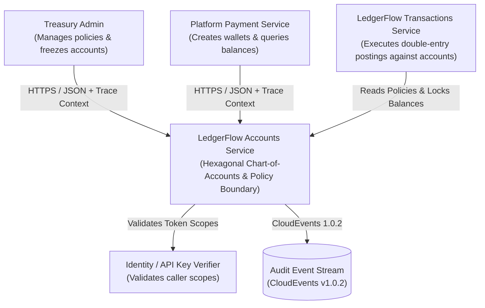
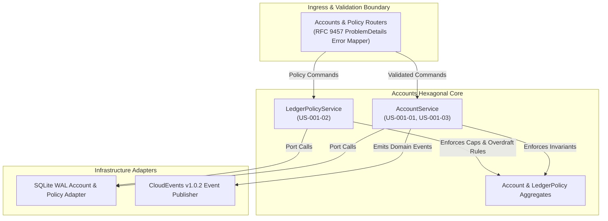
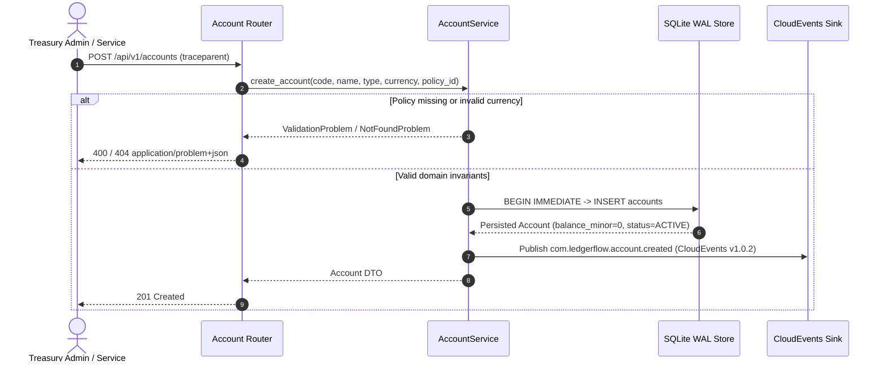

# LedgerFlow Accounts — High-Level Design Specification

## 1. System Overview & Architectural Approach (ISO/IEC/IEEE 42010)
The `accounts` domain follows a hexagonal (ports-and-adapters) modular service design isolating pure financial domain invariants (`Account`, `LedgerPolicy`, normal balance rules, closure zero-balance checks) from persistence and event transport. Incoming API calls traverse stateless FastAPI routers into application services (`AccountService`, `LedgerPolicyService`), which coordinate transactional persistence through `AccountRepositoryPort` and `LedgerPolicyRepositoryPort` backed by SQLite WAL.

Every account creation or lifecycle state transition (`ACTIVE` -> `FROZEN` -> `CLOSED`) emits a standardized CNCF CloudEvents v1.0.2 envelope propagated with a W3C `traceparent` header over an abstract `EventPublisherPort`, enabling downstream reconciliation consumers without coupling domain logic to message broker drivers. This satisfies capabilities `US-001-01`, `US-001-02`, and `US-001-03`.

## 2. System Topology (C4 Context & Container)

### 2.1 C4 System Context Diagram


### 2.2 Component Container Boundaries


## 3. Component Specifications

### 3.1 `AccountService`
* **Single Responsibility:** Provisioning accounts (`US-001-01`), retrieving point balances, and enforcing safe lifecycle transitions (`US-001-03`: freeze, unfreeze, zero-balance closure).
* **Public Interface:** `create_account(...)`, `get_account(account_id)`, `list_accounts(currency)`, `transition_status(account_id, new_status)`.
* **Dependencies:** `AccountRepositoryPort`, `LedgerPolicyRepositoryPort`, `EventPublisherPort`.
* **Statefulness:** Stateless application orchestrator.
* **Failure Blast Radius:** Isolated per HTTP request; SQLite transaction rollback prevents partial account/event writes.

### 3.2 `LedgerPolicyService`
* **Single Responsibility:** Managing reusable `LedgerPolicy` constraints (`allow_overdraft`, `max_posting_minor`, allowed status guard) satisfying `US-001-02`.
* **Public Interface:** `create_policy(...)`, `get_policy(policy_id)`, `evaluate_posting(account, signed_delta_minor)`.
* **Dependencies:** `LedgerPolicyRepositoryPort`.
* **Statefulness:** Stateless policy evaluator backed by transactional storage.
* **Failure Blast Radius:** Invalid policy definitions fail fast with RFC 9457 HTTP `400`/`422` without persisting invalid rules.

## 4. End-to-End Data Flow & Sequence



### 4.1 Asynchronous Event Envelope (CNCF CloudEvents v1.0.2 & W3C Trace Context)
```json
{
  "specversion": "1.0",
  "id": "evt_01JCH9X2Q7M0E5B8W4K9R3P2V1",
  "source": "/ledgerflow/accounts-service",
  "type": "com.ledgerflow.account.created",
  "datacontenttype": "application/json",
  "subject": "acct_01JCH9X2Q7M0E5B8W4K9R3P2V1",
  "time": "2026-11-20T12:45:00Z",
  "traceparent": "00-4bf92f3577b34da6a3ce929d0e0e4736-00f067aa0ba902b7-01",
  "data": {
    "account_id": "acct_01JCH9X2Q7M0E5B8W4K9R3P2V1",
    "code": "CASH-USD-001",
    "currency": "USD",
    "account_type": "ASSET",
    "status": "ACTIVE"
  }
}
```

## 5. Failure Modes & Resilience Strategy
| Dependency | Timeout | Retry Policy | Fallback / Blast Radius Mitigation |
|---|---|---|---|
| SQLite WAL Connection | `busy_timeout = 5000ms` | Bounded retry on transient `SQLITE_BUSY` lock contention | Roll back write unit immediately and surface HTTP `503` RFC 9457 Problem Details |
| `EventPublisherPort` | `500ms` sink timeout | In-memory synchronous queue buffer for tests / fail-safe structured log warning | Never roll back committed financial state if telemetry sink degrades; emit alert log with `traceparent` |

## 6. Cross-Cutting Concerns (Observability, Security & Trust Boundaries)
* **Trust Boundary 1 (HTTP Ingress -> Router):** Reject malformed JSON, negative policy caps, and non-ISO currency codes at input validation boundaries.
* **Trust Boundary 2 (Service -> Persistence):** Enforce parameterized SQL bindings and `CHECK` constraints (`balance_minor`, enum statuses).
* **Telemetry:** OpenTelemetry W3C `traceparent` propagated across synchronous HTTP boundaries and CloudEvents v1.0.2 event headers; structured `logging` without secret leakage.

## 7. Technology Candidates (ADR Triggers)
| Component / Concern | Candidate Options | Decision Status | Triggered ADR |
|---|---|---|---|
| Relational Storage & Locking | SQLite WAL (`BEGIN IMMEDIATE`), PostgreSQL, EventStoreDB | Needs ADR | `ADR-001-sqlite-double-entry-ledger` |
| Audit Event Envelope & Errors | CloudEvents v1.0.2 + RFC 9457, Custom JSON, Unstructured Logs | Needs ADR | `ADR-002-cloudevents-audit-stream` |
