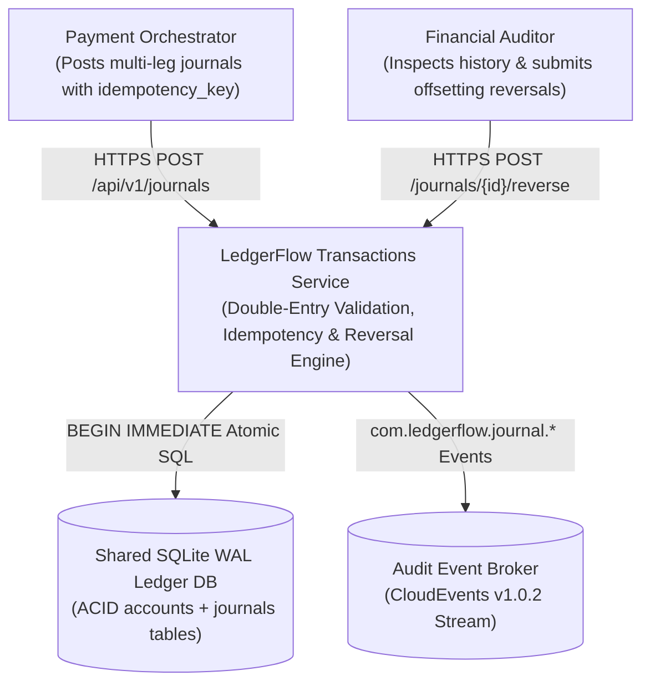
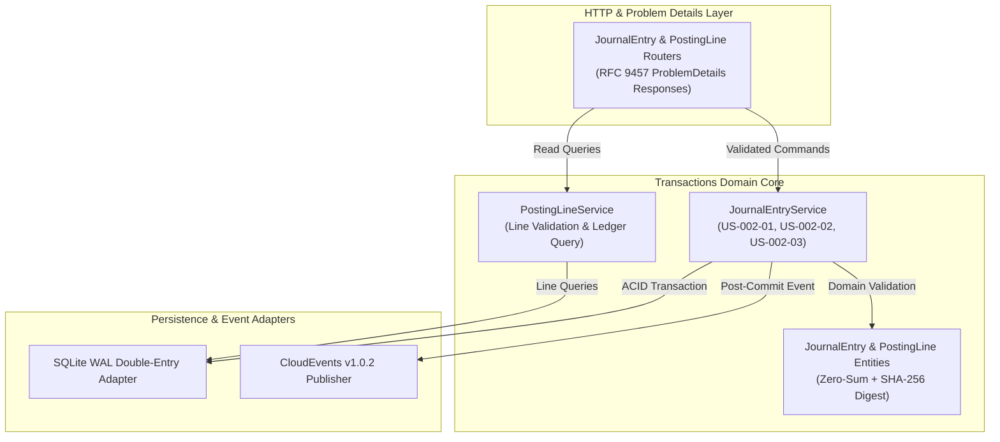
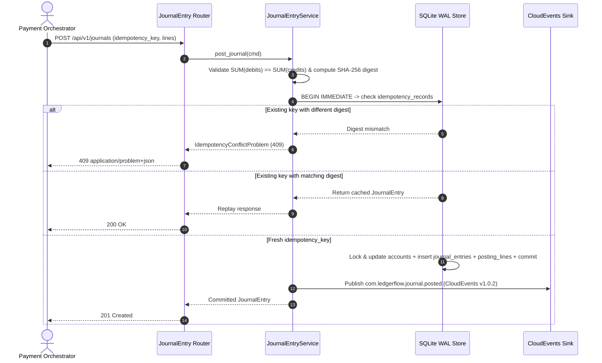

# LedgerFlow Transactions — High-Level Design Specification

## 1. System Overview & Architectural Approach (ISO/IEC/IEEE 42010)
The `transactions` domain implements atomic, idempotent double-entry bookkeeping across ledger accounts. Guided by clean hexagonal isolation, `JournalEntryService` and `PostingLineService` validate zero-sum invariants (`SUM(debits) == SUM(credits)`), uniform currency per posting batch, and `idempotency_key` SHA-256 request digests before acquiring a serialized write transaction via `JournalEntryRepositoryPort`.

During commit, the persistence adapter acquires a SQLite WAL `BEGIN IMMEDIATE` write lock, verifies each referenced account is `ACTIVE` and passes `LedgerPolicy` overdraft and single-posting limits, applies signed minor-unit balance deltas, persists immutable `journal_entries`, `posting_lines`, and `idempotency_records` rows, and commits atomically. Post-commit, `EventPublisherPort` emits CNCF CloudEvents v1.0.2 envelopes with W3C `traceparent`. This architecture satisfies `US-002-01`, `US-002-02`, and `US-002-03`.

## 2. System Topology (C4 Context & Container)

### 2.1 C4 System Context Diagram


### 2.2 Component Container Boundaries


## 3. Component Specifications

### 3.1 `JournalEntryService`
* **Single Responsibility:** Enforcing zero-sum double-entry invariants (`US-002-01`), canonical SHA-256 idempotent deduplication (`US-002-02`), and immutable offsetting reversals (`US-002-03`).
* **Public Interface:** `post_journal(...)`, `reverse_journal(journal_id, idempotency_key, reason)`, `get_journal(journal_id)`, `list_journals()`.
* **Dependencies:** `JournalEntryRepositoryPort`, `PostingLineRepositoryPort`, `EventPublisherPort`.
* **Statefulness:** Stateless orchestrator; durability and mutual exclusion live in SQLite WAL `BEGIN IMMEDIATE` transactions.
* **Failure Blast Radius:** Any domain rule, policy, or SQL failure rolls back the entire unit cleanly with zero side-effect balance mutation.

### 3.2 `PostingLineService`
* **Single Responsibility:** Constructing normalized `PostingLine` leg records and querying account ledger statements cleanly.
* **Public Interface:** `list_lines_for_journal(journal_id)`, `list_lines_for_account(account_id)`.
* **Dependencies:** `PostingLineRepositoryPort`.
* **Statefulness:** Stateless read/projection service.
* **Failure Blast Radius:** Read-only boundary; zero write mutation surface.

## 4. End-to-End Data Flow & Sequence



### 4.1 Asynchronous Event Envelope (CNCF CloudEvents v1.0.2 & W3C Trace Context)
```json
{
  "specversion": "1.0",
  "id": "evt_01JCHA4K2R9P0T6N3M8V1W5Y7Q",
  "source": "/ledgerflow/transactions-service",
  "type": "com.ledgerflow.journal.posted",
  "datacontenttype": "application/json",
  "subject": "jrnl_01JCHA4K2R9P0T6N3M8V1W5Y7Q",
  "time": "2026-11-20T12:45:00Z",
  "traceparent": "00-4bf92f3577b34da6a3ce929d0e0e4736-b7ad6b7169203331-01",
  "data": {
    "journal_id": "jrnl_01JCHA4K2R9P0T6N3M8V1W5Y7Q",
    "idempotency_key": "pay-order-991",
    "currency": "USD",
    "total_amount_minor": 10000,
    "line_count": 2,
    "status": "POSTED"
  }
}
```

## 5. Failure Modes & Resilience Strategy
| Dependency | Timeout | Retry Policy | Fallback / Blast Radius Mitigation |
|---|---|---|---|
| SQLite WAL Lock | `busy_timeout = 5000ms` | Caller-safe retry via stable `idempotency_key` | Full ACID rollback preserves double-entry invariant on lock timeout |
| Referenced Account State | Immediate check inside write tx | Zero silent auto-unfreeze | Returns HTTP `422 Unprocessable Content` RFC 9457 detailing blocked account |

## 6. Cross-Cutting Concerns (Observability, Security & Trust Boundaries)
* **Trust Boundary 1 (Canonical Digest):** Normalized JSON serialization (`sort_keys=True`) prevents bypass of idempotency conflict detection via field reordering.
* **Trust Boundary 2 (Account Policy Enforcement):** Overdraft and single-posting limits checked atomically under write lock before modifying account balance rows.
* **Observability:** Correlation propagates via `traceparent` across HTTP headers, logs, and CloudEvents v1.0.2 messages.

## 7. Technology Candidates (ADR Triggers)
| Component / Concern | Candidate Options | Decision Status | Triggered ADR |
|---|---|---|---|
| Atomic Double-Entry Persistence | SQLite WAL (`BEGIN IMMEDIATE`), PostgreSQL, EventStoreDB | Needs ADR | `ADR-001-sqlite-double-entry-ledger` |
| Event Telemetry & HTTP Errors | CloudEvents v1.0.2 + RFC 9457, Custom JSON, Plaintext | Needs ADR | `ADR-002-cloudevents-audit-stream` |
