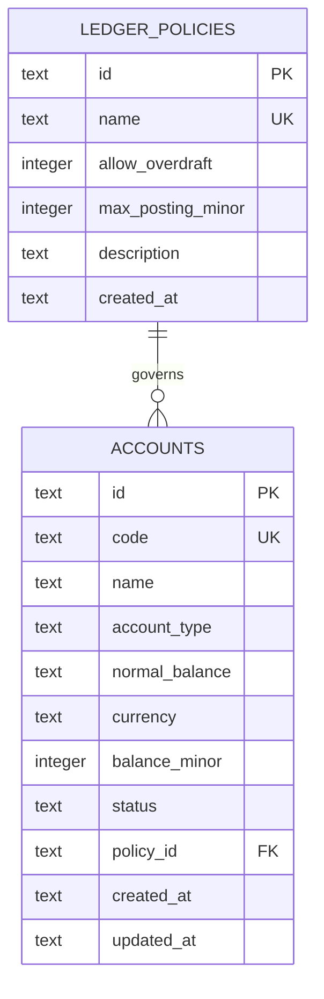

# LLD-001: Accounts Domain Detailed Design & Contract Specifications

Applies directives from `ADR-001-sqlite-double-entry-ledger` (SQLite WAL, integer minor units, parameterized SQL) and `ADR-002-cloudevents-audit-stream` (RFC 9457 `ProblemDetails` and CNCF CloudEvents v1.0.2). Satisfies requirements `US-001-01`, `US-001-02`, and `US-001-03`.

## 1. Domain-Driven Design (DDD) Aggregates & Invariants

### 1.1 Aggregate Root: `Account` (`US-001-01`, `US-001-03`)
* **Attributes:** `id` (`str`, `acct_<uuid>`), `code` (`str`, `^[A-Z0-9][A-Z0-9_-]{2,31}$`), `name` (`str`), `account_type` (`ASSET` | `LIABILITY` | `EQUITY` | `REVENUE` | `EXPENSE`), `normal_balance` (`DEBIT` | `CREDIT`), `currency` (`USD` | `EUR` | `GBP`), `balance_minor` (`int`), `status` (`ACTIVE` | `FROZEN` | `CLOSED`), `policy_id` (`str`), `created_at` (`str` UTC ISO-8601), `updated_at` (`str` UTC ISO-8601).
* **Domain Invariants:**
  * Normal balance derives deterministically from `account_type`: `ASSET` / `EXPENSE` -> `DEBIT`; `LIABILITY` / `EQUITY` / `REVENUE` -> `CREDIT`.
  * `currency` is immutable post-creation and restricted to supported ISO-4217 uppercase 3-letter codes (`USD`, `EUR`, `GBP`).
  * Transition to `CLOSED` is forbidden whenever `balance_minor != 0`. Re-opening a `CLOSED` account is rejected.
* **Domain Events Emitted:** `com.ledgerflow.account.created`, `com.ledgerflow.account.status_changed`.

### 1.2 Entity: `LedgerPolicy` (`US-001-02`)
* **Attributes:** `id` (`str`, `pol_<uuid>`), `name` (`str`), `allow_overdraft` (`bool`), `max_posting_minor` (`int > 0`), `description` (`str`), `created_at` (`str` UTC ISO-8601).
* **Domain Invariants:**
  * `max_posting_minor` MUST be strictly positive (`>= 1`).
  * `evaluate_posting(account, signed_balance_delta_minor)` rejects postings on `FROZEN`/`CLOSED` accounts, rejects magnitudes exceeding `max_posting_minor`, and rejects resulting negative natural balance when `allow_overdraft` is `False`.

### 1.3 Entity Relationship Diagram


---

## 2. Database Schema & DDL Migrations (SQLite 3 WAL Mode, per ADR-001)
```sql
PRAGMA journal_mode = WAL;
PRAGMA foreign_keys = ON;

CREATE TABLE IF NOT EXISTS ledger_policies (
    id TEXT PRIMARY KEY,
    name TEXT UNIQUE NOT NULL,
    allow_overdraft INTEGER NOT NULL DEFAULT 0 CHECK (allow_overdraft IN (0, 1)),
    max_posting_minor INTEGER NOT NULL CHECK (max_posting_minor > 0),
    description TEXT NOT NULL DEFAULT '',
    created_at TEXT NOT NULL
);

CREATE TABLE IF NOT EXISTS accounts (
    id TEXT PRIMARY KEY,
    code TEXT UNIQUE NOT NULL,
    name TEXT NOT NULL,
    account_type TEXT NOT NULL CHECK (account_type IN ('ASSET', 'LIABILITY', 'EQUITY', 'REVENUE', 'EXPENSE')),
    normal_balance TEXT NOT NULL CHECK (normal_balance IN ('DEBIT', 'CREDIT')),
    currency TEXT NOT NULL CHECK (currency IN ('USD', 'EUR', 'GBP')),
    balance_minor INTEGER NOT NULL DEFAULT 0,
    status TEXT NOT NULL DEFAULT 'ACTIVE' CHECK (status IN ('ACTIVE', 'FROZEN', 'CLOSED')),
    policy_id TEXT NOT NULL,
    created_at TEXT NOT NULL,
    updated_at TEXT NOT NULL,
    FOREIGN KEY (policy_id) REFERENCES ledger_policies(id)
);

CREATE INDEX IF NOT EXISTS idx_accounts_code ON accounts(code);
CREATE INDEX IF NOT EXISTS idx_accounts_currency_status ON accounts(currency, status);
```

---

## 3. API & Asynchronous Event Contracts (per ADR-002)

### 3.1 RESTful OpenAPI 3.1 Contract & RFC 9457 Problem Details
```yaml
openapi: "3.1.0"
info:
  title: "LedgerFlow Accounts API"
  version: "1.0.0"
paths:
  /api/v1/policies:
    post:
      summary: Create a LedgerPolicy constraint profile
      responses:
        "201": { description: Policy created }
        "400": { $ref: "#/components/responses/ProblemResponse" }
        "409": { $ref: "#/components/responses/ProblemResponse" }
  /api/v1/accounts:
    post:
      summary: Open a strongly typed ledger account (US-001-01)
      responses:
        "201": { description: Account created with balance_minor = 0 }
        "400": { $ref: "#/components/responses/ProblemResponse" }
        "404": { $ref: "#/components/responses/ProblemResponse" }
        "409": { $ref: "#/components/responses/ProblemResponse" }
    get:
      summary: List ledger accounts optionally filtered by currency
      responses:
        "200": { description: Account collection }
  /api/v1/accounts/{account_id}:
    get:
      summary: Fetch account summary and linked LedgerPolicy (US-001-02)
      responses:
        "200": { description: Account detail }
        "404": { $ref: "#/components/responses/ProblemResponse" }
  /api/v1/accounts/{account_id}/status:
    patch:
      summary: Transition account status ACTIVE/FROZEN/CLOSED (US-001-03)
      responses:
        "200": { description: Updated Account }
        "404": { $ref: "#/components/responses/ProblemResponse" }
        "409": { $ref: "#/components/responses/ProblemResponse" }
components:
  schemas:
    ProblemDetails:
      type: object
      required: [type, title, status, detail]
      properties:
        type: { type: string, format: uri }
        title: { type: string }
        status: { type: integer }
        detail: { type: string }
        instance: { type: string }
        error_code: { type: string }
  responses:
    ProblemResponse:
      description: RFC 9457 Problem Details response
      content:
        application/problem+json:
          schema: { $ref: "#/components/schemas/ProblemDetails" }
```

### 3.2 Async Event Envelope (CNCF CloudEvents v1.0.2 & W3C Trace Context)
```json
{
  "specversion": "1.0",
  "id": "evt_01JCH9X2Q7M0E5B8W4K9R3P2V1",
  "source": "/ledgerflow/accounts-service",
  "type": "com.ledgerflow.account.status_changed",
  "datacontenttype": "application/json",
  "subject": "acct_01JCH9X2Q7M0E5B8W4K9R3P2V1",
  "time": "2026-11-20T12:50:00Z",
  "traceparent": "00-4bf92f3577b34da6a3ce929d0e0e4736-00f067aa0ba902b7-01",
  "data": {
    "account_id": "acct_01JCH9X2Q7M0E5B8W4K9R3P2V1",
    "previous_status": "ACTIVE",
    "new_status": "FROZEN"
  }
}
```

---

## 4. Project Structure & Scaffolding Blueprint

### Modules
| Module | Scaffold | Entities | Description |
|---|---|---|---|
| accounts-service | python-fastapi | Account, LedgerPolicy | Chart-of-accounts, lifecycle, and policy governance service |
