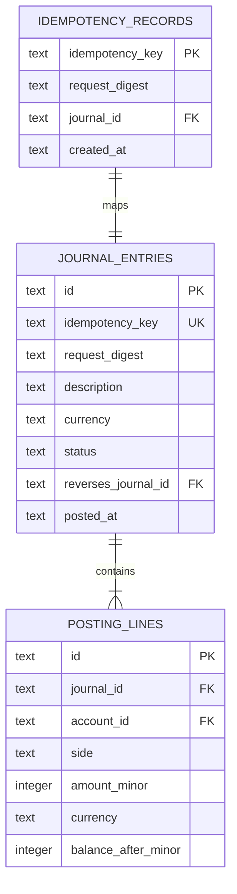

# LLD-002: Transactions Domain Detailed Design & Contract Specifications

Applies directives from `ADR-001-sqlite-double-entry-ledger` (SQLite WAL `BEGIN IMMEDIATE`, integer minor units, parameterized SQL) and `ADR-002-cloudevents-audit-stream` (RFC 9457 `ProblemDetails` and CNCF CloudEvents v1.0.2). Satisfies requirements `US-002-01`, `US-002-02`, and `US-002-03`.

## 1. Domain-Driven Design (DDD) Aggregates & Invariants

### 1.1 Aggregate Root: `JournalEntry` (`US-002-01`, `US-002-02`, `US-002-03`)
* **Attributes:** `id` (`str`, `jrnl_<uuid>`), `idempotency_key` (`str`, non-empty client deduplication key), `request_digest` (`str`, 64-char SHA-256 hex), `description` (`str`), `currency` (`USD` | `EUR` | `GBP`), `status` (`POSTED` | `REVERSED`), `reverses_journal_id` (`str | None`), `lines` (`tuple[PostingLine, ...]`), `posted_at` (`str` UTC ISO-8601).
* **Domain Invariants:**
  * Contains at least 2 `PostingLine` legs with strictly positive integer `amount_minor`.
  * All `PostingLine` legs share the same `currency` and zero-sum balance: `sum(DEBIT amount_minor) == sum(CREDIT amount_minor)`.
  * Canonical SHA-256 `request_digest` deterministically detects identical retry vs `409 Conflict` key reuse.
  * Offsetting reversal produces a new `JournalEntry` flipping every `DEBIT <-> CREDIT` leg while linking `reverses_journal_id`; already reversed journals refuse second reversal with `409 Conflict`.
* **Domain Events Emitted:** `com.ledgerflow.journal.posted`, `com.ledgerflow.journal.reversed`.

### 1.2 Value / Entity: `PostingLine` (`US-002-01`)
* **Attributes:** `id` (`str`, `line_<uuid>`), `journal_id` (`str`), `account_id` (`str`), `side` (`DEBIT` | `CREDIT`), `amount_minor` (`int > 0`), `currency` (`USD` | `EUR` | `GBP`), `balance_after_minor` (`int`).
* **Balance Math Helper:** For `DEBIT`-normal accounts (`ASSET`, `EXPENSE`), `DEBIT` adds `+amount_minor` and `CREDIT` adds `-amount_minor`; for `CREDIT`-normal accounts (`LIABILITY`, `EQUITY`, `REVENUE`), `CREDIT` adds `+amount_minor` and `DEBIT` adds `-amount_minor`.

### 1.3 Entity Relationship Diagram


---

## 2. Database Schema & DDL Migrations (SQLite 3 WAL Mode, per ADR-001)
```sql
PRAGMA journal_mode = WAL;
PRAGMA foreign_keys = ON;

CREATE TABLE IF NOT EXISTS journal_entries (
    id TEXT PRIMARY KEY,
    idempotency_key TEXT UNIQUE NOT NULL,
    request_digest TEXT NOT NULL,
    description TEXT NOT NULL,
    currency TEXT NOT NULL CHECK (currency IN ('USD', 'EUR', 'GBP')),
    status TEXT NOT NULL DEFAULT 'POSTED' CHECK (status IN ('POSTED', 'REVERSED')),
    reverses_journal_id TEXT UNIQUE,
    posted_at TEXT NOT NULL
);

CREATE TABLE IF NOT EXISTS posting_lines (
    id TEXT PRIMARY KEY,
    journal_id TEXT NOT NULL,
    account_id TEXT NOT NULL,
    side TEXT NOT NULL CHECK (side IN ('DEBIT', 'CREDIT')),
    amount_minor INTEGER NOT NULL CHECK (amount_minor > 0),
    currency TEXT NOT NULL CHECK (currency IN ('USD', 'EUR', 'GBP')),
    balance_after_minor INTEGER NOT NULL,
    FOREIGN KEY (journal_id) REFERENCES journal_entries(id)
);

CREATE TABLE IF NOT EXISTS idempotency_records (
    idempotency_key TEXT PRIMARY KEY,
    request_digest TEXT NOT NULL,
    journal_id TEXT NOT NULL,
    created_at TEXT NOT NULL,
    FOREIGN KEY (journal_id) REFERENCES journal_entries(id)
);

CREATE INDEX IF NOT EXISTS idx_posting_lines_journal ON posting_lines(journal_id);
CREATE INDEX IF NOT EXISTS idx_posting_lines_account ON posting_lines(account_id);
```

---

## 3. API & Asynchronous Event Contracts (per ADR-002)

### 3.1 RESTful OpenAPI 3.1 Contract & RFC 9457 Problem Details
```yaml
openapi: "3.1.0"
info:
  title: "LedgerFlow Transactions API"
  version: "1.0.0"
paths:
  /api/v1/journals:
    post:
      summary: Post atomic idempotent double-entry journal (US-002-01, US-002-02)
      responses:
        "201": { description: Journal committed cleanly }
        "200": { description: Idempotent replay of previously committed journal }
        "400": { $ref: "#/components/responses/ProblemResponse" }
        "404": { $ref: "#/components/responses/ProblemResponse" }
        "409": { $ref: "#/components/responses/ProblemResponse" }
        "422": { $ref: "#/components/responses/ProblemResponse" }
    get:
      summary: List committed journal entries
      responses:
        "200": { description: JournalEntry list }
  /api/v1/journals/{journal_id}:
    get:
      summary: Retrieve single JournalEntry with PostingLines
      responses:
        "200": { description: JournalEntry detail }
        "404": { $ref: "#/components/responses/ProblemResponse" }
  /api/v1/journals/{journal_id}/reverse:
    post:
      summary: Create offsetting reversal JournalEntry (US-002-03)
      responses:
        "201": { description: Reversal committed cleanly }
        "404": { $ref: "#/components/responses/ProblemResponse" }
        "409": { $ref: "#/components/responses/ProblemResponse" }
  /api/v1/accounts/{account_id}/lines:
    get:
      summary: Query PostingLine history for an account
      responses:
        "200": { description: PostingLine list }
components:
  schemas:
    ProblemDetails:
      type: object
      required: [type, title, status, detail]
      properties:
        type: { type: string, format: uri }
        title: { type: string }
        status: { type: integer }
        detail: { type: string }
        instance: { type: string }
        error_code: { type: string }
  responses:
    ProblemResponse:
      description: RFC 9457 Problem Details response
      content:
        application/problem+json:
          schema: { $ref: "#/components/schemas/ProblemDetails" }
```

### 3.2 Async Event Envelope (CNCF CloudEvents v1.0.2 & W3C Trace Context)
```json
{
  "specversion": "1.0",
  "id": "evt_01JCHA4K2R9P0T6N3M8V1W5Y7Q",
  "source": "/ledgerflow/transactions-service",
  "type": "com.ledgerflow.journal.posted",
  "datacontenttype": "application/json",
  "subject": "jrnl_01JCHA4K2R9P0T6N3M8V1W5Y7Q",
  "time": "2026-11-20T12:50:00Z",
  "traceparent": "00-4bf92f3577b34da6a3ce929d0e0e4736-b7ad6b7169203331-01",
  "data": {
    "journal_id": "jrnl_01JCHA4K2R9P0T6N3M8V1W5Y7Q",
    "idempotency_key": "pay-order-991",
    "currency": "USD",
    "total_amount_minor": 10000,
    "status": "POSTED"
  }
}
```

---

## 4. Project Structure & Scaffolding Blueprint

### Modules
| Module | Scaffold | Entities | Description |
|---|---|---|---|
| transactions-service | python-fastapi | JournalEntry, PostingLine | Atomic double-entry posting, idempotency, reversal, and CloudEvents audit service |
