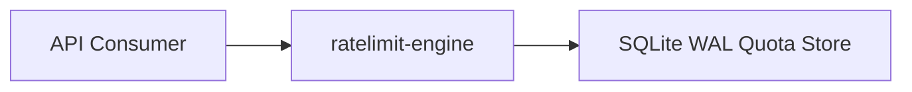

# HLD-001: PulseGate Edge Rate-Limiting Topology

## 1. System Topology

## 2. Technology Decisions
| Concern | Candidate | Status |
|---|---|---|
| Atomic Token-Bucket Persistence | SQLite WAL + BEGIN IMMEDIATE | Needs ADR |
| Error Contract | RFC 9457 Problem Details | Adopted |
