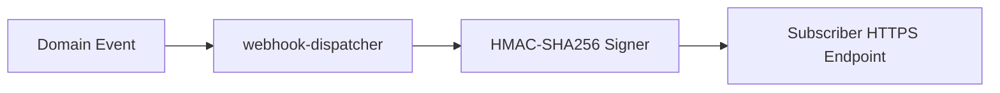

# HLD-002: PulseGate Webhook Delivery Topology

## 1. System Topology

## 2. Cross-Project Federation
* Reuses `ext://ledger/ADR-002-cloudevents-audit-stream` for CNCF CloudEvents v1.0.2 envelope headers (`specversion`, `id`, `source`, `type`) and RFC 9457 error formatting.

## 3. Technology Decisions
| Concern | Candidate | Status |
|---|---|---|
| Delivery State Persistence | SQLite WAL | Needs ADR |
